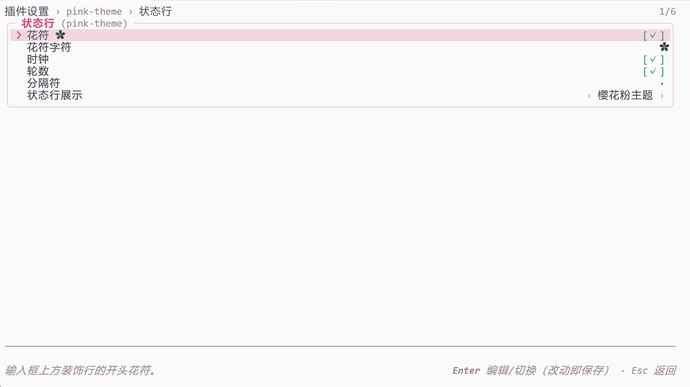

# dsh-tui-theme 🌸

**简体中文** | [English](README_EN.md)

[dsh-TUI](https://github.com/ccch1mneyyy/dsh-TUI) 的花符状态行插件：输入框上方一行 `✿ · 时钟 · 轮数`，外加一个 `/settings` 可编辑区块与一条一次性迁移提示，全部走官方接缝，不注册快捷键或命令。

> **0.8 起本插件不再提供主题。** 樱花粉三套（`pink-night` / `pink-day` / `pink-ansi`）已移交上游：上游 PR [#1294](https://github.com/ccch1mneyyy/dsh-TUI/pull/1294) 已于 2026-10-12 合并进 dsh-TUI 主线（merge `4f4980fe`），并**自 dsh-TUI 0.15.0 起作为宿主内置预设发布**，调色板与主题键由上游维护；本包只保留非主题的装饰部分，也就不会再与内置主题抢名字、抢文件或抢调色板。宿主 < 0.15.0 时粉主题名只能来自 0.7.x 留下的旧主题文件（见「迁移要点」），那些宿主上全新安装拿不到粉主题名，需要主题本身时请继续用 `dsh-tui-theme@0.7.5`。

## 0.8 变更（升级前请读）

| 0.7.x 的能力 | 0.8 的状态 |
| --- | --- |
| 三套粉主题（运行时注册 / 静态安装） | **移除**。宿主内置同名主题后，其优先级高于任何同名 `~/.dsh-tui/themes/*.json` |
| 缓存背景跟随（`followSystem`） | **移除**（该功能只为在昼樱/夜樱间切换而存在） |
| 旧主题文件遮蔽检测 + 清理对话框 | **移除**；改为一次性 toast 提示（见下） |
| 花符状态行（含富状态视图配色） | **保留**，配色改为包内嵌的家族三色（`src/palette.ts`） |
| `/settings` 里的 **dsh-tui-theme** 区块（0.7.x 名为 `pink-theme`） | **保留**，只剩「状态行」一组字段 |
| toast 通道 | **保留**，用于上面那条迁移提示 |

迁移要点：

- 插件不再写入 `~/.dsh-tui`（唯一例外是迁移提示的标记文件 `theme-plugin-notice.json`：发现旧主题文件、且提示确实送达宿主后才写一次）。插件只**读**宿主的 `theme.json` 判断当前主题。
- 0.7.x 装过的 `~/.dsh-tui/themes/pink-*.json` 等文件不会被删除。**宿主已内置樱族时**（dsh-TUI ≥ 0.15.0）它们不再生效（内置优先于同名文件）；**0.15.0 之前的宿主**仍把这些文件当静态主题解析，从 0.7.x 升上来的用户照旧可用。
- 如果你手动改过这些文件的配色：**要改的是文件里的 `name` 字段**（宿主按它去重，文件名只是标签）。只把 `pink-night.json` 改名成 `my-pink.json` 而 `name` 仍是 `pink-night`，`/theme` 列表里不会出现它，选中 `pink-night` 拿到的仍是内置调色板——等于没改（实测）。把 `name` 改成别的粉外名（建议 `displayName`、文件名一起改成 `my-pink`），再到宿主 `/theme` 里选中它，内置才会让位给你这一份。注意状态行展示范围 `statusScope` 默认是 `pink-only`，只认 `pink-*` 三个名字——换名后请到 `/settings` 把「状态行展示」改成「所有主题」，否则状态行会消失。
- 发现旧主题文件后会发一条中性 toast 提示；**提示送达宿主后**才记标记、之后不再重复。宿主还没有 toast 接缝（< 0.10）时看不到提示：插件当次启动静默重试，下次启动再试，不打扰也不放弃——等宿主升上来，提示照常出现一次。被提到的文件不会被动过。
- `~/.dsh-tui/theme-follow.json` 已无人读取，可自行删除。

## 能力一览

| 能力 | 接缝 | 说明 |
| --- | --- | --- |
| **花符状态行** | `tuiStatus` | 输入框上方一行装饰：✿ · 时钟 · 实时轮数；默认仅在内置樱花粉主题下显示 |
| **富状态视图** | `tuiStatus.registerView`（≥ 0.10.1） | 一行 React 视图，用包内嵌的家族调色板上色；旧宿主自动回退到无色标量行 |
| **设置面板** | `tuiSettingsSections` | `/settings` 里一个可编辑区块（花符 / 花符字符 / 时钟 / 轮数 / 分隔符 / 展示范围），保存即时生效 |
| **迁移提示** | `tuiToast`（≥ 0.10.0） | 发现 ≤0.7.x 留下的 `pink-*.json` 时提示，送达后不再重复；无接缝的旧宿主静默重试、不报错 |

**明确不做的事**：不注册快捷键、不注册或修改命令、不拦截输入、不追加会话事件、不注入 system prompt、不安装或注册任何主题文件。

## 快速开始

```sh
# 0.8 尚未发版（npm 上 @latest 是带主题的 0.7.5）。发布后预发布版需显式版本：
# dsh plugin --profile dsh-tui add -w dsh-tui-theme@0.8.0-pre.2
```

本地 tarball 安装（开发 / 自用）：

```sh
cd /path/to/dsh-tui-theme
npm run build
npm pack
dsh plugin --profile dsh-tui add -w ./dsh-tui-theme-0.8.0-pre.2.tgz
```

> 不要以本地源码目录作为依赖安装：其开发 `node_modules` 可能与 dsh-TUI 宿主解析出不同的 Cordis/DSH framework instance，插件会无法注册服务。

装好后状态行只在樱花粉主题下出现；想在任何主题下都显示，把 `/settings` 里的「状态行展示」改成「所有主题」（那里不上色）。

## 配置

优先级：`/settings` 用户层 > `cordis.yml` 配置层 > 内置默认值。在 `/settings` 里找到 **dsh-tui-theme** 区块：

| 字段 | 默认 | 说明 |
| --- | --- | --- |
| `showGlyph` | `true` | 花符开关：开 = 以花符开头，关 = 不显示 |
| `statusGlyph` | `✿` | 花符字符：1–2 个显示单元、不接受控制字符，留空恢复默认 |
| `showClock` | `true` | 显示 HH:MM 时钟 |
| `showTurns` | `true` | 显示当前会话轮数（`N✦`，自本次启动起计） |
| `statusSeparator` | `·` | 各段之间的分隔符，校验规则同花符字符 |
| `statusScope` | `pink-only` | 状态行展示：`pink-only` 仅内置樱花粉主题 / `all-themes` 所有主题（非粉主题下无色） |

三项装饰（花符 / 时钟 / 轮数）全关时状态行整体消失。另有仅 profile 层的开关（写在 `cordis.patch.yml`，不出现在 `/settings`）：`statusEnabled`。

> 上表就是本插件的可编辑面：卡片字段与 `src/liveConfig.ts` 的 `LIVE_CONFIG_KEYS` 逐键相等，由 `npm run verify` 双向断言。

### 截图

`/settings` 里 0.7.x 卡片的「状态行」分组（实测于 dsh-TUI 0.14.0 + 插件 v0.7.5）：图中标题里的 `pink-theme` 是 0.7.x 的卡片名（0.8 起为 **dsh-tui-theme**）；这一屏的六项与 0.8 的卡片一致，0.7.x 的「背景跟随」组（含 `followSystem`）在 0.8 已整组移除，所以 0.8 的卡片只有这一个组。



## 迁移提示（toast）

插件日志对 TUI 用户不可见，因此唯一值得知道的事件走宿主 toast（≥ 0.10.0 的 `tuiToast` 接缝，纯输出、不拦截任何输入；旧宿主没有该接缝，自动静默）：

| 事件 | 提示 |
| --- | --- |
| 发现 ≤0.7.x 留下的 `pink-*.json` | ✿ 发现旧主题文件 …：dsh-TUI 若已内置同名粉主题则优先于它；改过配色请改文件里的 name，并把状态行展示改为「所有主题」（pink-only 只认 pink-*） |

提示只在**确实送达宿主**后记一次（标记文件 `~/.dsh-tui/theme-plugin-notice.json`）。宿主还没有 toast 接缝（< 0.10）时每次都静默重试、不打扰：等宿主升到带该接缝的版本，提示才出现一次，之后不再重复。只点名插件当年装过的那三个文件名——你自己建的主题文件永远不会被提及。插件不会删除或修改这些文件。

## 状态行与主题的关系

- 状态行是**装饰**：宿主负责渲染、截断与清理，插件只提交标量文本或一行组件。
- **可见性判定**沿用宿主自己的主题优先级：`DSH_TUI_THEME` 环境变量 > `~/.dsh-tui/theme.json` 持久选择（宿主 0.14.0 起还多一层品牌默认档，可以盖过 `theme.json`，见「兼容性」）。因此插件只知道“当前主题名”，不缓存调色板；`pink-only` 判据就是那三个内置名。
- **配色**来自 `src/palette.ts` 里内嵌的三个色值（家族 `accent` / `inactiveShimmer` / `subtle`，与宿主内置樱族逐键一致）。宿主没有向插件公开“当前调色板”的查询接缝（运行时主题服务只收注册、不回读），所以这是插件唯一持有的颜色来源；非粉主题一律不着色。
- **标量行在旧宿主上由宿主统一以无色 + dim 渲染**，插件无法控制颜色——这是宿主行为，富状态视图（≥ 0.10.1）正是为了绕开它。
- 插件不安装、不注册、不修补任何主题文件，也不修改 `theme.json`（那是宿主的用户偏好）。

## 卸载

```sh
# 移除插件
dsh plugin --profile dsh-tui remove -w dsh-tui-theme
```

### 旧主题文件清理（卸载前后都适用）

`~/.dsh-tui/themes/pink-*.json` 是宿主的用户数据，**插件不会替你删除**（0.8 起只发一条一次性提示，也不改写它们），卸载更不会动它们。宿主内置樱族后这三个文件不再生效，留着只是死重量，且宿主目前不会对此作任何提示——清理只能手动做：

```sh
# POSIX：确认没有要保留的手改配色后（要保留先按「迁移要点」改 name）
rm ~/.dsh-tui/themes/pink-{night,day,ansi}.json
rm ~/.dsh-tui/theme-follow.json
rm ~/.dsh-tui/theme-plugin-notice.json
```

```powershell
# PowerShell（Windows）：同上，可只删其中几个
Remove-Item "$env:USERPROFILE\.dsh-tui\themes\pink-night.json",
            "$env:USERPROFILE\.dsh-tui\themes\pink-day.json",
            "$env:USERPROFILE\.dsh-tui\themes\pink-ansi.json"
Remove-Item "$env:USERPROFILE\.dsh-tui\theme-follow.json" -ErrorAction SilentlyContinue
Remove-Item "$env:USERPROFILE\.dsh-tui\theme-plugin-notice.json" -ErrorAction SilentlyContinue
```

`theme-follow.json`（0.7.x 的背景跟随缓存）与 `theme-plugin-notice.json`（本插件的迁移标记）都不是主题，删掉只是丢一点历史状态。**别把 `theme.json` 一起删**——那是宿主记录当前主题选择的文件。

## 兼容性

- **dsh-TUI 下限 0.8.8**（状态行与设置面板，0.9.3 实测）。0.10.1 起状态行走富状态视图按内嵌调色板上色，更旧宿主自动回退无色标量行；缺 `dsh-tui-extensions` 扩展面的宿主自动静默降级，不报错。
- **主题由宿主提供**：`pink-night` / `pink-day` / `pink-ansi` 自 dsh-TUI 0.15.0 起随宿主内置（上游 PR #1294 维护调色板与主题键），本包不再携带。**`pink-only` 判据只是主题名，不检查宿主是否内置**：三个名字取自 `DSH_TUI_THEME` 或 `~/.dsh-tui/theme.json`——在 ≥ 0.15.0 的宿主上与内置名天然一致。**宿主 < 0.15.0 时**：从 0.7.x 升上来、`~/.dsh-tui/themes/pink-*.json` 还在的用户照常显示（宿主仍把那些文件当静态主题解析）；只有「未内置 + 没有这些旧文件」的全新安装拿不到粉主题名，`pink-only` 下状态行不会显示——此时改用 `statusScope: all-themes`，或继续使用 `dsh-tui-theme@0.7.5`。
- **宿主 0.14.0 起多一层「品牌默认档」，可以盖过 `theme.json`**：没有显式 `theme` prop 或 `DSH_TUI_THEME` 时，宿主按品牌（`DSH_TUI_BRAND` / 设置项 `dsh-tui.brand`）选 `claude-dark`/`claude-paper`（claude）或 `codex-lavender`/`codex-paper`（codex），且不对 `theme.json` 加锁。此时宿主渲染的是品牌主题，而插件仍按 `theme.json` 里的名字判定：那里若还是 `pink-*`，✿ 行照常显示并按樱族上色，与宿主实际渲染不一致——纯观感偏差，不会崩溃。默认品牌 `deepseek` 不在品牌表内，本插件也不读品牌设置：这是有意接受的一处偏差。
- **`dsh-settings` 两代都支持**：≤ 0.1.6（dsh-TUI 0.9.x/0.10.x）走插件注册命名空间 + `scope.watch`；≥ 0.1.7（dsh-TUI 0.11+）走 Config volatile 字段投影 + `loader/volatile-update` 重读。判定按能力探测，不解析版本号；两条路径的失败都写日志而不是静默。
- **dsh 运行时 `0.2.0-rc.1` 起有启动期 peer 校验**：宿主读 bundle 的 `peerDependencies`，把 `@deepseek-ai/dsh` / `@deepseek-ai/dsh-*` 段与运行时版本比对，不匹配就跳过整个 bundle（stderr 提示 `skipping profile bundle`）。本插件的 peer 段覆盖 `0.1.0-rc.6`–`0.1.x` 与 `0.2.0-rc.1`–`0.2.x`（自 v0.7.3 起，新世代写作 `^0.2.0-rc.1`），因此 0.2 宿主正常加载。宿主校验固定用 `includePrerelease` 语义，故 0.2 线的预发布档同样放行。
- Node `^22.19 || >=24`，纯 ESM，MIT。

## 开发

```sh
npm install --include=dev   # 本仓不提交 lockfile，务必带 --include=dev
npm run build
npm run verify
npm run verify:package
```

安装前提、验证脚本参数（`verify:settings` / `verify:host`）、CI 门禁与内嵌调色板的维护方式见 [docs/development.md](docs/development.md)。
